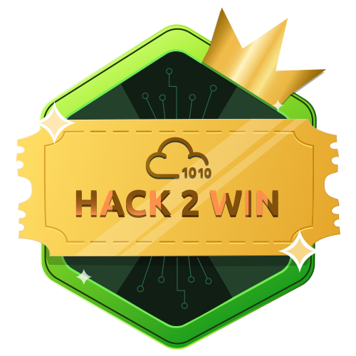
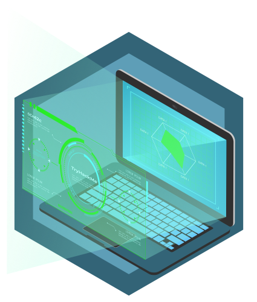
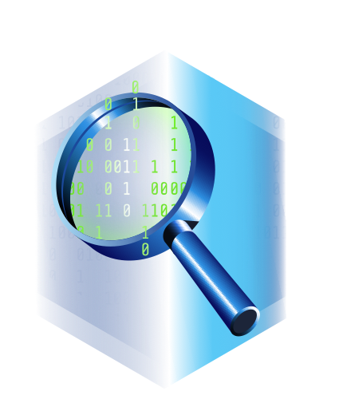
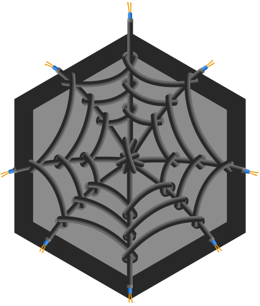

# 👋 Hi, I'm sudorzk
I'm a cybersecurity enthusiast interested in **Blue Team and Red Team operations**, with a focus on Network Security, Web Application Security, and Wireless Security.

My career goal is to become a **SOC Analyst or Junior Penetration Tester**. I'm interested in understanding how systems and networks work, identifying security weaknesses, and learning how security incidents can be detected and investigated.

I believe in learning through hands-on practice, understanding technical fundamentals, and documenting my progress.

---

## 🎯 Career Goals
- SOC Analyst
- Junior Penetration Tester

## 🔍 Security Interests

- Blue Team Operations & Security Monitoring
- Web Application Security
- Network Security & Penetration Testing
- Wireless Network Security
- Vulnerability Research

I also explore wireless network reconnaissance and wardriving as personal learning activities, focusing on understanding wireless infrastructure and security.

---

## 🛠️ Technical Experience

### Hands-on Experience

- **Red & Blue Team Lab:** Built a personal cybersecurity lab using VirtualBox, MikroTik CHR, Debian, Ubuntu, Kali NetHunter, and DVWA.
- **Web Security Testing:** Practiced vulnerability testing in DVWA and OWASP Juice Shop.
- **Network Security:** Configured MikroTik networks and performed basic network security testing.
- **Log Monitoring:** Set up a basic monitoring pipeline using Grafana, Loki, and Alloy to collect and visualize web server logs.
- **Security Tools:** Used Nmap, Subfinder, HTTPX, and Burp Suite during lab-based security testing.
- **Linux Systems:** Worked with Ubuntu, Debian, Kali Linux, and Kali NetHunter.
- **Mobile Environment Exploration:** Set up Kali NetHunter and explored Android custom ROM installation.  

---
## 📂 Projects

### Red & Blue Team Lab

A personal cybersecurity lab designed to practice web application security testing and understand how attack activities can be observed from a defensive perspective.

**Technologies:**
- VirtualBox
- MikroTik CHR
- Debian & Ubuntu
- Kali NetHunter
- DVWA
- Grafana
- Loki
- Alloy

**Project focus:**
- Network configuration and segmentation
- Web application security testing
- Log collection and visualization
- Observing security events from Red Team and Blue Team perspectives

[View Project Repository](https://github.com/sudo-rzk/red-blue-team-lab)

---
## 📜 Certifications & Learning

### Certifications Profesional
- [x] MikroTik Certified Network Associate | – MikroTik
- [x] MikroTik Certified Network Routing Engineer | – MikroTik

### Webinar Certificates
- [x] WEB PENTEST & BUG HUNTING L1 | – Jadi Hacker
- [x] Wordpress Security Researcher | - Merdeka Siber

## 🏅 TryHackMe Badges

  
  
  
  
  

  <a href="https://tryhackme.com/p/sudoe">
    View My TryHackMe Profile
  </a>

## 📖 Learning Principles

- Understand the fundamentals before relying on tools.
- Learn how systems work, not just how to operate security tools.
- Practice in controlled and authorized environments.
- Document findings, mistakes, and lessons learned.
- Continuously improve both offensive and defensive security skills.
---

